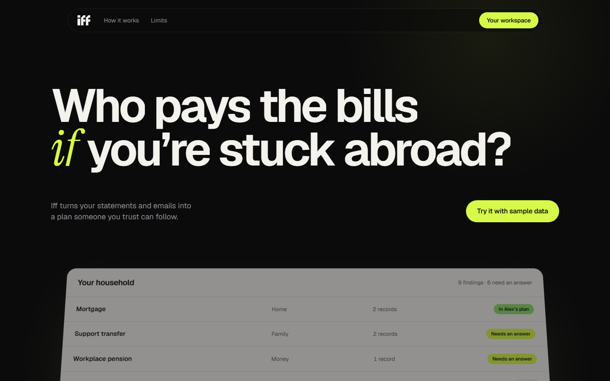
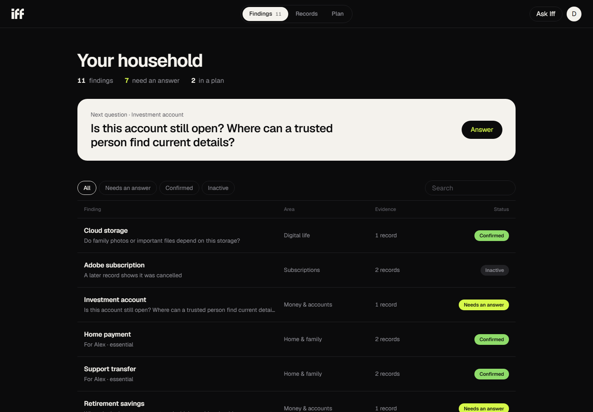
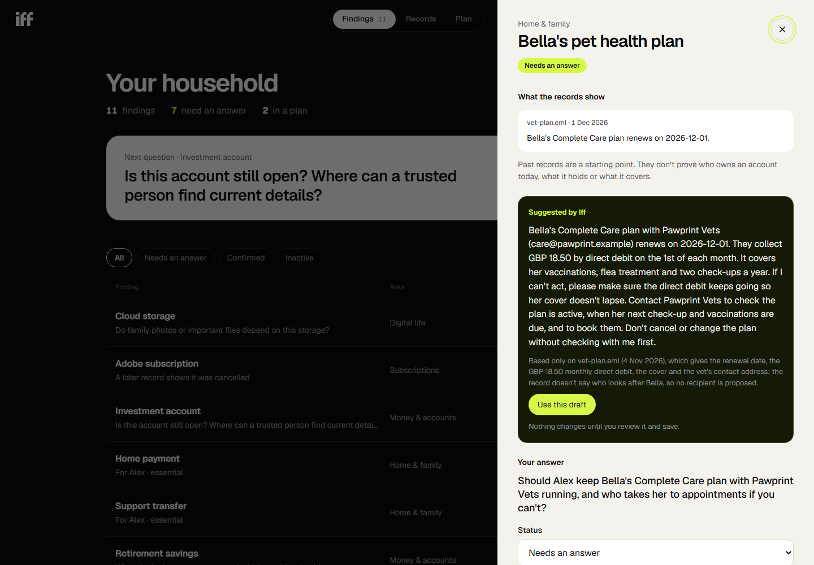
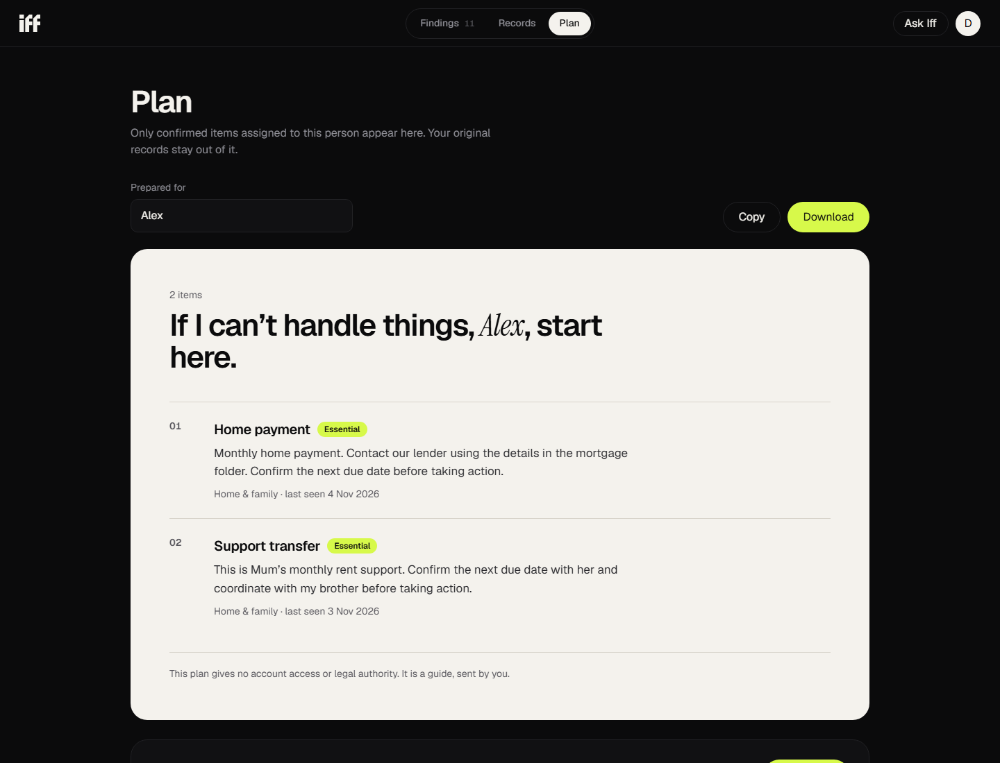
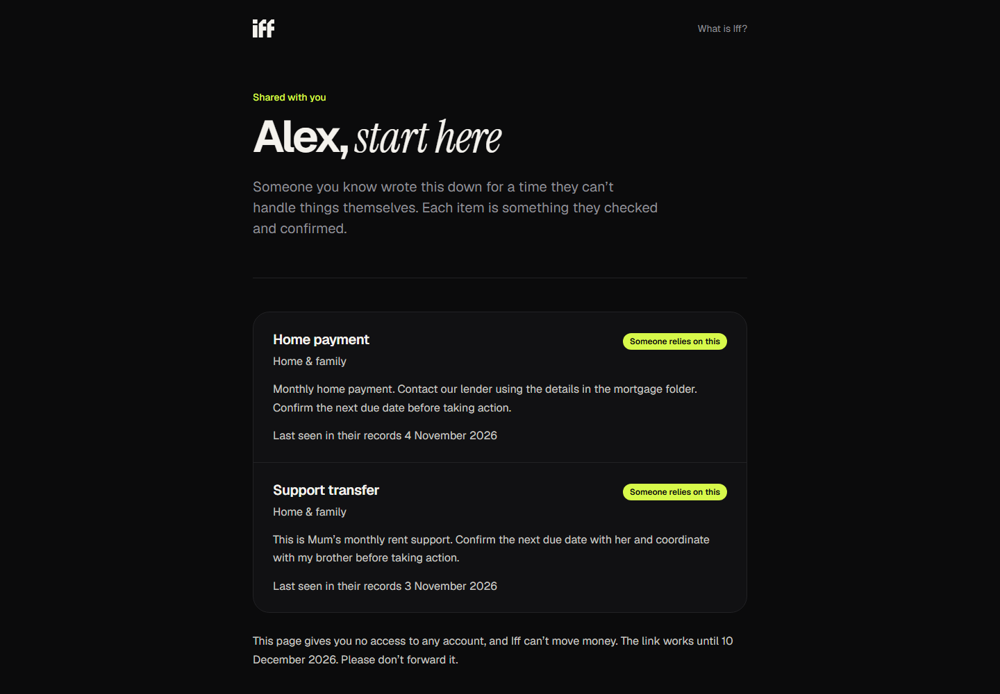
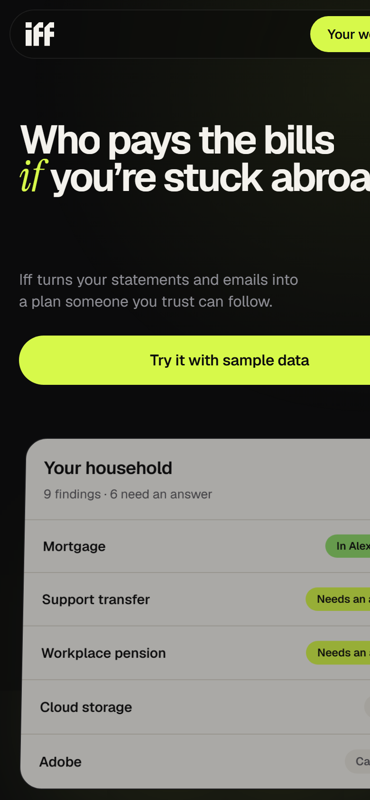
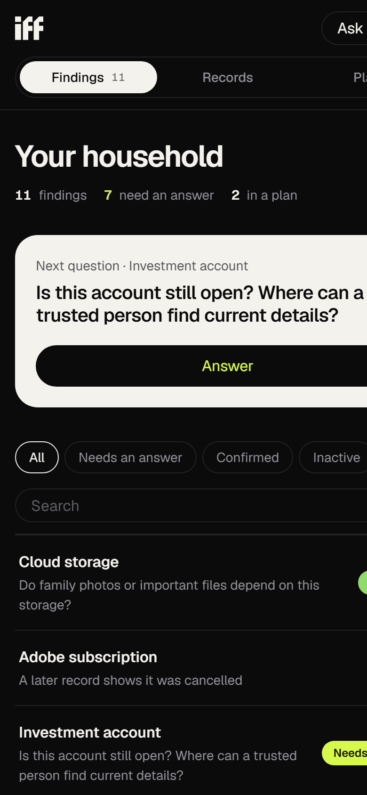
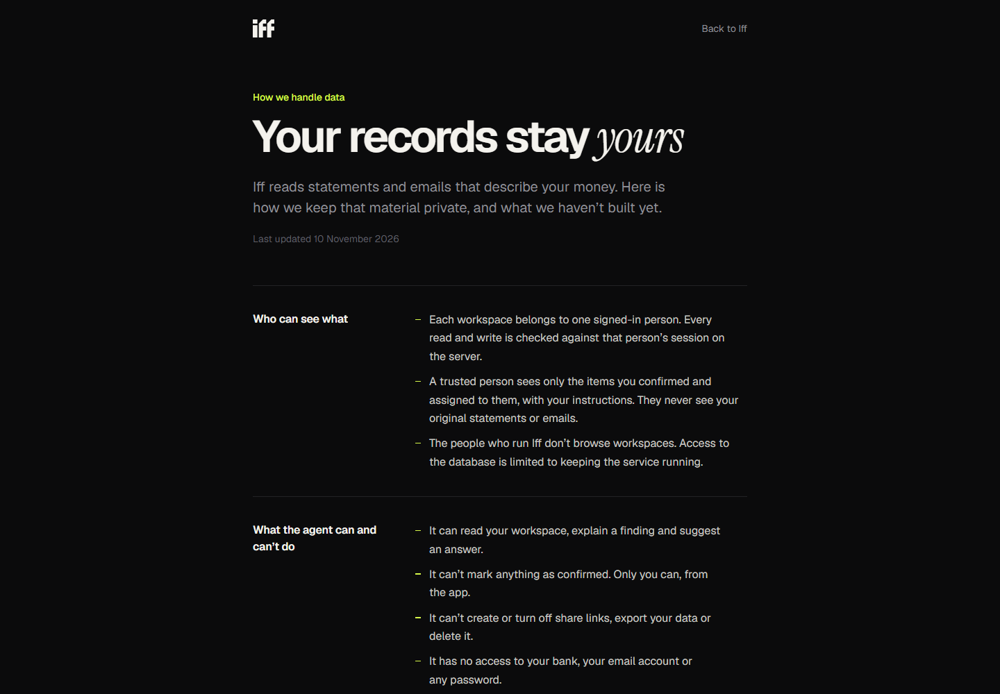

# Iff

Iff turns your statements and emails into a plan someone you trust can follow if you can't handle things yourself: you're in hospital, you've lost your phone, you're stuck abroad.

Built for the [Builder.io Agent-Native Hackathon](https://www.builder.io/hackathon) on the [Agent-Native](https://www.agent-native.com/docs/) framework.



## The problem

Most households run on what one person remembers. They know which payment is the mortgage, that the £300 transfer every month is their mum's rent, and that the £2.99 cloud plan holds every family photo. Nobody else knows. When that person can't answer, whoever steps in starts from a pile of bank statements and an inbox.

Iff reads those records, asks the owner about what it can't work out, and keeps the answers as a short plan for one trusted person. The plan says what to pay, where it comes from and who to call. The original records stay with the owner.

## How it works

1. **Add records.** Upload CSV statements, saved emails (`.eml`) or text files. Iff's built-in rules make a first pass and raise findings such as a mortgage, a support transfer or a subscription.
2. **The agent reads them too.** Each upload is handed to the Iff agent. It reads the record, raises anything the rules missed, and drafts an answer where the record gives enough to go on. Every finding the agent adds has to quote the record word for word. The server checks the quote and refuses the finding if the words aren't there.
3. **The owner answers.** Each finding shows the evidence and asks one question. The owner writes their own answer or uses the agent's draft, then marks it confirmed. The agent can't confirm anything.
4. **Share the plan.** The owner creates a private link for their trusted person. That person sees only the confirmed items assigned to them, never the records behind them. The owner can turn the link off at any time.

### Findings

The workspace lists every finding with its status. Findings raised by the agent are marked "Found by Iff", and findings with an answer waiting are marked "Draft ready".



### Evidence and the agent's draft

Opening a finding shows the exact lines from the records, a reminder that old records don't prove who owns an account today, and the agent's suggested answer. "Use this draft" copies it into the form. Nothing is saved until the owner presses Save.



### The plan

The plan holds confirmed items for one person, in plain language. It can be copied, downloaded or shared as a link.



### What the trusted person sees

The shared page needs no account. It lists the items, the owner's instructions and when each was last seen in the records. It gives no access to any account and asks search engines not to index it.



### On a phone

Every screen works at phone width.

<p>
  
  
</p>

## How Iff uses Agent-Native

Agent-Native apps give the user interface and the agent the same set of actions. Iff follows that closely and adds hard limits in code, so the agent's boundaries don't depend on its prompt.

### Actions

| Action | Used by | What it does |
|---|---|---|
| `iff-workspace` | agent and UI | Reads findings, records, questions and evidence |
| `iff-import` | agent and UI | Imports a record. The built-in rules raise findings |
| `iff-suggest` | agent | Raises a finding the rules missed. The quote must appear in the record word for word |
| `iff-draft` | agent | Proposes an answer for one finding. It appears as "Suggested by Iff" and changes nothing until the owner saves |
| `iff-update` | agent and UI | Saves the owner's answer. Only a call from the app can set a finding to confirmed |
| `iff-note` | agent and UI | Records something the owner says directly, kept as its own evidence |
| `iff-handover`, `iff-export` | agent and UI | The plan for one person: confirmed, assigned items only |
| `iff-demo` | agent and UI | Loads the fictional sample household |
| `iff-invite` | UI only | Creates, lists and turns off share links |
| `iff-my-data` | UI only | Exports or deletes the owner's workspace |
| `view-screen` | agent | What the owner is looking at: the open finding with its evidence and draft, the visible list, or the plan |
| `navigate` | agent | Opens a finding, a section or a person's plan on the owner's screen |

### Limits enforced in code

- **Only the owner confirms.** `iff-update` rejects `status: "confirmed"` unless the call comes from the app itself (`ctx.caller === "frontend"`).
- **Sharing, export and deletion are the owner's decisions.** `iff-invite` and `iff-my-data` set `agentTool: false`, so the agent can't call them.
- **The agent's findings must cite real text.** `iff-suggest` checks the quote against the stored record before saving.
- **The agent can correct itself.** Checking actions use `fail()` for clear error messages and set `retrySafe`, so a rejected call goes back to the model to fix its arguments.
- **Records are untrusted.** The system prompt tells the agent to ignore instructions inside imported records, and never to state balances, ownership or legal authority from old records.

### Context

`view-screen` and `navigate` give the agent the same view as the owner. When the owner asks about a finding, the agent can open it on their screen while it explains. The plan's recipient is kept in the URL (`?for=Alex`), so the agent knows whose plan is open.

`agent-native doctor` reports no findings.

## Privacy and accounts

- **Separate workspaces.** Each workspace belongs to one signed-in person. The server keys every read and write to that person's session.
- **Sample workspace without sign-up.** "Try it with sample data" creates a private guest workspace. It is deleted, with anything added to it and any links made from it, 24 hours later.
- **Passkey accounts.** Creating an account needs no email and no password. Iff stores only the passkey's public key. A guest can keep their sample workspace by saving it with a passkey. Email and password sign-in is also available.
- **Share links.** Only a fingerprint of each link is stored. Links expire after 30 days and can be turned off at any time, and the owner can see when each one was last opened.
- **Owner controls.** The account menu has "Download my data" (JSON) and "Delete my workspace".
- **No trackers.** Iff sets one sign-in cookie and uses no advertising or analytics trackers.
- **Operator screens.** The framework's settings, database and observability screens are limited to emails listed in `IFF_ADMIN_EMAILS`. Agent messages are capped per person per day.

The app includes a [privacy notice](app/routes/privacy.tsx), [terms of use](app/routes/terms.tsx) and a page on [how Iff handles data](app/routes/trust.tsx). That last page also lists what isn't done yet.



## Run it locally

You need Node 22.22 or later.

```bash
npm install
npm run dev
```

Open http://127.0.0.1:8080/welcome. Connect a model provider (Builder.io or an Anthropic key) under Settings so "Ask Iff" can answer. Local development uses a built-in PGlite database, so no database setup is needed.

To check the code:

```bash
npm run typecheck
node --test tests/iff-domain.test.mjs
npm run agent-native:doctor
```

## Deploy

Set these on your host. Never commit them.

| Variable | Purpose |
|---|---|
| `DATABASE_URL` | Hosted Postgres connection string |
| `BETTER_AUTH_SECRET` | 32 or more random characters, used to sign sessions |
| `ANTHROPIC_API_KEY` | Lets signed-in users and guests use the agent on your account |
| `IFF_ADMIN_EMAILS` | Comma-separated emails that may open the operator screens |
| `VITE_IFF_CONTACT_EMAIL` | Contact address shown in the privacy notice and terms |
| `IFF_GUEST_DAILY_MESSAGES`, `IFF_USER_DAILY_MESSAGES` | Optional daily agent message caps (default 15 and 60) |

Passkeys only work on a real domain served over HTTPS.

## Project layout

```
actions/                 Actions shared by the UI and the agent (iff-*.ts, navigate, view-screen)
app/routes/welcome.tsx   Landing page
app/routes/home.tsx      Workspace: findings, records and plan
app/routes/start.tsx     Passkey sign-in
app/routes/p.$token.tsx  Shared plan page
app/components/          Account menu, share panel, policy page layout
server/iff/domain.ts     Built-in rules, sample household and plan builder
server/iff/store.ts      One workspace per signed-in person
server/iff/access.ts     Guests, operators, daily caps and share links
server/routes/api/iff/   Guest sandbox, passkeys, shared plan and account info
server/middleware/       Operator screen guard and agent message cap
server/plugins/          Database migrations, auth settings and the agent's instructions
```

## Limits

- No live bank or inbox connection. Records are uploaded by hand.
- No PDF or scanned documents yet. CSV, `.eml` and text files under 100 KB only.
- Iff can't move money, contact a bank or act on any account.
- Findings from old records are clues. They don't prove current balances, ownership or cover.
- A plan isn't a will or a power of attorney and gives nobody legal authority.
- Passkey sign-in hasn't been tested end to end on a deployed domain yet.
- No independent security audit has been done.

## What's next

- Let the trusted person ask Iff questions that are answered only from their plan.
- Read PDF bank statements.
- A "first two weeks" view: what's due soon, who depends on it, and what still has no instructions.
- Flag items whose last evidence is months old so the owner checks they're still true.

## Sample data

The sample household (Maya, Alex, Bella the dog and the merchants) is fictional. Any resemblance to real people or accounts is accidental.
